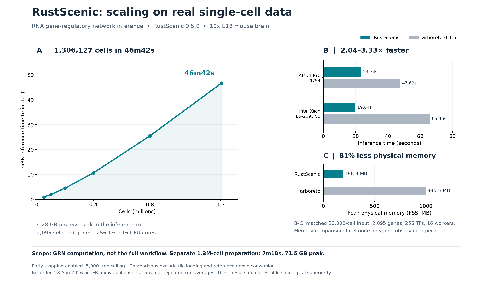

<p align="center">
  
</p>

<h1 align="center">RustScenic</h1>

<p align="center">
  <strong>Predict how genes are regulated from single-cell data.</strong>
</p>

<p align="center">
  Fast regulatory-network analysis in Rust, with a Python API.<br>
  Created by <strong>Ekin Kahraman</strong>, developed and scaled with the
  <strong>Huang Lab at Mount Sinai</strong>.
</p>

<p align="center">
  <a href="https://github.com/Ekin-Kahraman/rustscenic/actions/workflows/audit.yml"></a>
  <a href="https://pypi.org/project/rustscenic/"></a>
  <a href="LICENSE"></a>
  <a href="https://doi.org/10.5281/zenodo.20246040"></a>
  <br>
  <a href="https://github.com/Ekin-Kahraman/rustscenic/actions/workflows/docs.yml"></a>
  <a href="https://github.com/Ekin-Kahraman/rustscenic/actions/workflows/nightly-real-data.yml"></a>
  <a href="https://www.python.org/"></a>
  <a href="https://www.rust-lang.org/"></a>
</p>

<p align="center">
  <a href="https://ekin-kahraman.github.io/rustscenic/">Documentation</a> ·
  <a href="https://github.com/Ekin-Kahraman/rustscenic/blob/main/site_docs/benchmarks.md">Benchmarks</a> ·
  <a href="site_docs/validation.md">Validation</a> ·
  <a href="examples/cellxgene-endothelial/README.md">Try the example</a> ·
  <a href="https://doi.org/10.5281/zenodo.20246040">Cite the software</a>
</p>

- **1.3 million real cells:** GRN inference in **46m42s on 16 CPU cores**,
  using 2,095 selected genes and 256 transcription factors.
- **2.04–3.33× faster than arboreto** in matched 20,000-cell comparisons;
  **81% lower physical memory** in the measured Intel-node comparison.
- **704 human cell-ontology labels:** precomputed exploratory networks from
  CELLxGENE Census, with source attribution and reproducible methods.

## Try a network

[Download the small endothelial-cell example](https://raw.githubusercontent.com/Ekin-Kahraman/rustscenic/main/examples/cellxgene-endothelial/starter.zip), extract it and
open `explore.html`. Choose a regulator to see its predicted targets.
No installation, HPC connection or new model fitting is needed.

The example includes the complete **184,000-edge network**, **85 motif-supported
regulons**, activity summaries and source-study citations.

For Python users:

```bash
python3 example.py --tf ETS1
```

## Performance



The million-cell result measures GRN inference on prepared mouse-brain RNA.
Separate input preparation took **7m18s** and peaked at **71.5 GB**, versus
**4.28 GB** during inference. The arboreto comparisons use matching inputs
and worker counts; each is a single observation, not a repeated-run average.
These results were measured on the **v0.5.0 release candidate** and do not
describe a complete million-cell spatial workflow.

[Exact measurements and conditions](docs/benchmarks/real-rna-20260828/benchmark-source-record.md) ·
[SCENIC+ comparisons and output agreement](site_docs/benchmarks.md)

Additional measured results:

- **21.4% lower topic-model peak memory:** 1,668.2 → 1,312.0 MB median
  across three baseline and three optimised mouse-brain runs, with identical
  output files. This v0.5.0 candidate audit used five sampling sweeps to test
  storage efficiency, not model convergence.
  [Memory audit](validation/scaling/IFB_SCALE_2026-08-28.md#compact-gibbs-token-audit).
- **11–52× faster than SCENIC+** on selected stages using sampled real-data
  inputs of 1,500–2,000 cells. Enhancer-linking methods differ, and output
  agreement is incomplete; these timings do not establish equivalent
  scientific performance.

<details>
<summary>SCENIC+ comparison: timings, input sizes and conditions</summary>

| Dataset | Input: cells / genes / peaks / TFs | RustScenic | SCENIC+ | Speedup | Peak RSS: RustScenic / SCENIC+ |
| --- | ---: | ---: | ---: | ---: | ---: |
| PBMC3k dense | 2,000 / 4,000 / 8,000 / 30 | 4.98 s | 258.9 s | 52× | 1.21 / 1.26 GB |
| PBMC10k dense | 2,000 / 4,000 / 8,000 / 30 | 21.5 s | 241.5 s | 11× | 2.37 / 2.63 GB |
| Mouse brain E18 | 1,500 / 3,000 / 6,000 / 25 | 2.82 s | 90.4 s | 32× | 1.65 / 2.10 GB |
| Human brain GEM-X | 2,000 / 4,000 / 8,000 / 30 | 7.41 s | 146.0 s | 19.7× | 2.18 / 2.19 GB |

Measured on an Apple M5, 16 GB RAM, macOS arm64, four CPU threads and seed
777. Python: 3.13.9 for RustScenic; 3.11.8 for SCENIC+. Shapes are the actual
sampled benchmark inputs. Including preparation, the human-brain row totals
**11.89 s versus 150.36 s**.

The comparison starts with prepared RNA, ATAC and cistromes, and measures
GRN inference, enhancer links, eRegulons and gene/region AUCell. It excludes
raw-fragment processing, topic modelling, motif-database construction and
workflow scheduling. RustScenic uses correlation over a fixed search space
for enhancer links; SCENIC+ uses boosted trees plus Pearson scoring.

[Commands and output agreement](site_docs/benchmarks.md) ·
[Recorded measurements](validation/head_to_head/head_to_head_summary.json)

</details>

## Validation

| Check | Result |
| --- | --- |
| Huang Lab human-brain run | **16/17 expected transcription factors** recovered in 8,215 post-QC cells with v0.4.6. A biological sanity check, not an accuracy estimate. |
| AUCell vs pySCENIC | Ziegler 2021 airway atlas: mean per-cell Pearson **0.984**; **91.7%** of cells above 0.95. |
| cisTarget AUC kernel vs ctxcore | Pearson **1.0000**; mean absolute difference approximately **2.4e-5**. |
| Human brain GEM-X vs SCENIC+ | Region-to-gene edge Jaccard **1.000** under the fixed search space; region AUCell mean Pearson **0.823**. |
| Remaining output differences | On the same GEM-X comparison, gene AUCell Pearson is **0.386** and eRegulon edge Jaccard is **0.161**. Full output parity is not claimed. |

[Validation and limitations](site_docs/validation.md) ·
[Huang Lab run record](validation/community/human_brain_10k_v0.4.6.json) ·
[Benchmark output agreement](site_docs/benchmarks.md#validation)

## Analyse your own data

Current release: `v0.5.0`. Python **3.10–3.13**; Linux, macOS and Windows.
Runs on CPUs; no GPU required.

```bash
pip install rustscenic
```

RustScenic supports RNA regulatory-network inference, motif enrichment,
regulon activity scoring and multiome analysis through a Python API and CLI.
Core analysis runs without Java, Dask, CUDA or Snakemake.

<details>
<summary>Python quickstart: infer a network and score candidate gene sets</summary>

Start with a human RNA AnnData file (`rna.h5ad`) with gene symbols matching
the bundled transcription-factor list. These candidate sets are not
motif-filtered or split by correlation sign.

```python
import anndata as ad
import rustscenic.aucell
import rustscenic.data
import rustscenic.grn

adata = ad.read_h5ad("rna.h5ad")
tfs = rustscenic.data.tfs("hs")

grn = rustscenic.grn.infer(
    adata, tf_names=tfs, n_estimators=500, top_targets_per_tf=50, seed=777
)
regulons = {
    tf: group["target"].tolist()
    for tf, group in grn.groupby("TF")
    if len(group) >= 10
}
auc = rustscenic.aucell.score(adata, regulons, top_frac=0.05)
auc.to_parquet("aucell.parquet")
```

For target sets separated by correlation sign, use `add_correlation`,
`build_regulons` or the `rustscenic add-cor` command; see the
[API map](site_docs/api.md). A correlation sign is not experimental proof
of activation or repression.

</details>

<details>
<summary>Command-line examples</summary>

Run the RNA pipeline, or individual stages with the corresponding inputs:

```bash
rustscenic pipeline --rna rna.h5ad --tfs tfs.txt --output out/
rustscenic grn --expression rna.h5ad --tfs tfs.txt --output grn.parquet
rustscenic aucell --expression rna.h5ad --regulons grn.parquet --output aucell.parquet
rustscenic topics --expression atac.h5ad --output topics.parquet --n-topics 30
rustscenic cistarget --rankings rankings.feather --regulons regulons.tsv --output motifs.parquet
```

The topic model requires an ATAC matrix; cisTarget requires prepared motif
rankings and gene sets. See the [quickstart](site_docs/quickstart.md) for
input guidance.

</details>

<details>
<summary>API coverage: eight analysis stages</summary>

| Stage | Python API | Purpose |
| --- | --- | --- |
| Gene networks | `rustscenic.grn.infer` | GRNBoost2-style TF-to-gene inference |
| AUCell | `rustscenic.aucell.score` | Per-cell gene-set activity |
| cisTarget | `rustscenic.cistarget.enrich` | Motif enrichment and support filtering |
| Topics | `rustscenic.topics.fit`, `fit_gibbs` | scATAC topic modelling |
| ATAC preprocessing | `rustscenic.preproc` | Fragment matrix building and QC |
| Enhancer links | `rustscenic.enhancer.link_peaks_to_genes` | Peak-to-gene linking |
| eRegulons | `rustscenic.eregulon.build_eregulons` | Enhancer-linked regulon assembly |
| Pipeline | `rustscenic.pipeline.run` | Staged RNA and multiome workflows |

</details>

<details>
<summary>Upgrading from 0.4.x</summary>

v0.5.0 follows arboreto's GRN stopping rule and defaults to separate activator
and repressor regulons in the pipeline. To reproduce older behaviour, use
`early_stop_mode="legacy_inbag"` for GRN fitting and
`grn_regulon_polarities="unsigned"` in the pipeline.

See the [v0.5.0 release notes](docs/releases/v0.5.0.md) for memory improvements
and compatibility details. v0.5.0 is Apache-2.0; earlier published 0.4.x
releases remain MIT.

</details>

[Full quickstart](https://ekin-kahraman.github.io/rustscenic/quickstart/) ·
[PBMC3k end-to-end example](examples/pbmc3k_end_to_end.py) ·
[Tester guide](docs/tester-quickstart.md)

## CELLxGENE-derived resource

The collection contains **137.8 million retained edges** and **51,527
motif-supported regulons** across 704 human cell-ontology labels, drawing on
565 source datasets. Each cohort uses up to 5,000 balanced cells.

All outputs passed integrity and content-consistency checks. These are
exploratory predictions; motif support and successful execution do not
establish biological accuracy. Pooled cohorts span tissues and disease
annotations, and activity scores are not directly comparable across cohorts.

**Release status:** the collection is verified and packaged; the CELLxGENE
submission enquiry has been sent. Public resource and citation links will
be added when the release is available.

## Documentation

[Installation](site_docs/installation.md) ·
[API reference](site_docs/api.md) ·
[HPC operation](site_docs/hpc.md) ·
[Benchmarks](site_docs/benchmarks.md) ·
[Validation](site_docs/validation.md) ·
[Scope](site_docs/limitations.md) ·
[Release notes](docs/releases/v0.5.0.md)

## Citation and contribution

Cite the exact [RustScenic release](https://doi.org/10.5281/zenodo.20246040)
used; GitHub citation metadata is in [CITATION.cff](CITATION.cff).
When using the CELLxGENE-derived networks, also cite the resource when
available, CELLxGENE and the contributing studies supplied with the data.
Software: Apache-2.0. The resource has a separate data-licence notice.

Created and maintained by Ekin Kahraman; see [AUTHORS.md](AUTHORS.md)
for attribution.
Questions, bugs and reproducible examples are welcome in
[GitHub Issues](https://github.com/Ekin-Kahraman/rustscenic/issues).
