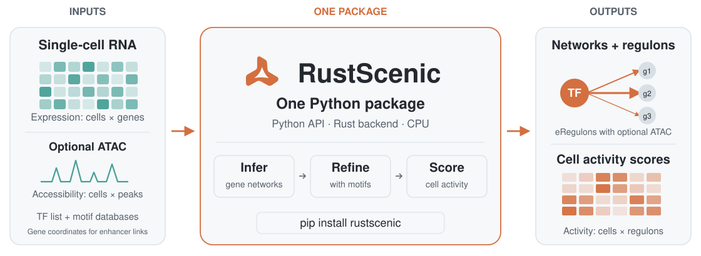
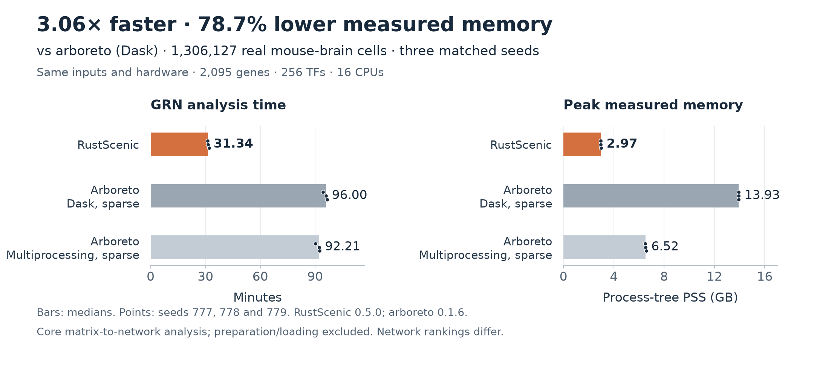

<p align="center">
  
</p>

<h1 align="center">
  <picture>
    <source media="(prefers-color-scheme: dark)" srcset="site_docs/assets/branding/rustscenic-wordmark-dark.svg">
    
  </picture>
</h1>

<p align="center">
  <strong>Built to be the simplest, fastest way to run regulatory-network analysis.</strong>
  <br><br>
</p>

<p align="center">
  <picture>
    <source media="(max-width: 600px) and (prefers-color-scheme: dark)" srcset="site_docs/assets/branding/rustscenic-workflow-mobile-dark.svg">
    <source media="(max-width: 600px)" srcset="site_docs/assets/branding/rustscenic-workflow-mobile-light.svg">
    <source media="(prefers-color-scheme: dark)" srcset="site_docs/assets/branding/rustscenic-workflow-dark.svg">
    
  </picture>
</p>

<p align="center">
  A Rust rewrite of core <a href="https://github.com/aertslab/pySCENIC">pySCENIC</a>
  and <a href="https://github.com/aertslab/scenicplus">SCENIC+</a> analysis stages, with a Python API.<br>
  Developed and scaled with the
  <strong><a href="https://labs.icahn.mssm.edu/kuanhuanglab/">Huang Lab at Mount Sinai</a></strong>.
</p>

<p align="center">
  <a href="https://github.com/Ekin-Kahraman/rustscenic/actions/workflows/audit.yml"></a>
  <a href="https://pypi.org/project/rustscenic/"></a>
  <a href="LICENSE"></a>
  <a href="https://doi.org/10.5281/zenodo.20246040"></a>
  <br>
  <a href="https://github.com/Ekin-Kahraman/rustscenic/actions/workflows/docs.yml"></a>
  <a href="https://github.com/Ekin-Kahraman/rustscenic/actions/workflows/nightly-real-data.yml"></a>
  <a href="https://www.python.org/"></a>
  <a href="https://www.rust-lang.org/"></a>
</p>

<p align="center">
  <a href="#get-started">Install</a> ·
  <a href="https://ekin-kahraman.github.io/rustscenic/">Documentation</a> ·
  <a href="https://github.com/Ekin-Kahraman/rustscenic/blob/main/site_docs/benchmarks.md">Benchmarks</a> ·
  <a href="site_docs/validation.md">Validation</a> ·
  <a href="https://ekin-kahraman.github.io/rustscenic/demo/endothelial/">Try the example</a> ·
  <a href="https://doi.org/10.5281/zenodo.23548341">Download the dataset</a> ·
  <a href="https://doi.org/10.5281/zenodo.20246040">Cite the software</a>
</p>

- **1.3 million real cells:** RNA gene regulatory network (GRN) inference in
  **31m20s on 16 CPU cores**,
  using 2,095 selected genes and 256 transcription factors.
- **3× faster than arboreto** in matched 1.3 million-cell comparisons;
  **~80% lower physical memory** in the measured Intel-node comparison.
- **704 human cell labels:** precomputed exploratory networks from CELLxGENE
  Census, [openly available on Zenodo](https://doi.org/10.5281/zenodo.23548341).
  Explore the endothelial-cell example below or download the full collection.

<br>

## Get started

Current release: `v0.5.1`. Regular CPython **3.10–3.14**; Linux, macOS and Windows.
Runs on CPUs; no GPU or Rust setup needed with prebuilt packages.

```bash
python -m pip install rustscenic
python -c "import rustscenic; print(rustscenic.__version__)"
```

Expected version: `0.5.1`. For a clean environment, see
[Installation](site_docs/installation.md).

### Run a working example

Run GRN inference and candidate gene-set scoring on PBMC3k in the
[executable notebook](examples/pbmc3k_quickstart.ipynb):

[](https://colab.research.google.com/github/Ekin-Kahraman/rustscenic/blob/main/examples/pbmc3k_quickstart.ipynb)

The notebook installs the published package, downloads the public RNA data and
saves network edges, per-cell activity scores and run settings. For a local
script, follow the [PBMC3k walkthrough](QUICKSTART.md).

### Analyse your own data

Use an RNA AnnData file (`rna.h5ad`) with cells × genes, log-normalised
expression in `adata.X` and gene symbols in `adata.var_names`.

```python
import anndata as ad
from rustscenic import data, grn

adata = ad.read_h5ad("rna.h5ad")
edges = grn.infer(
    adata, tf_names=data.tfs("hs"), n_estimators=500,
    top_targets_per_tf=50, seed=777,
)
edges.to_parquet("grn.parquet")
print(edges.head())
```

<details>
<summary>Input formats and species</summary>

The example uses human transcription factors; use `data.tfs("mm")` for mouse.
For expression layers and Ensembl identifiers, see the
[input guide](site_docs/quickstart.md#prepare-your-input).
For R inputs, see the [Seurat / R guide](https://ekin-kahraman.github.io/rustscenic/seurat-interop/)
for explicit RNA layer selection and a sparse matrix round-trip.

</details>

<details>
<summary>Score candidate gene-set activity</summary>

Continue with the network above. These candidate sets are not motif-filtered
or split by correlation sign.

```python
import rustscenic.aucell

regulons = {
    tf: group["target"].tolist()
    for tf, group in edges.groupby("TF")
    if len(group) >= 10
}
auc = rustscenic.aucell.score(adata, regulons, top_frac=0.05)
auc.to_parquet("aucell.parquet")
```

For target sets separated by correlation sign, use `add_correlation`,
`build_regulons` or the `rustscenic add-cor` command; see the
[API map](site_docs/api.md). A correlation sign is not experimental proof
of activation or repression.

</details>

<details>
<summary>Command-line examples</summary>

Run the RNA pipeline on the same prepared `rna.h5ad`. The `hs` shortcut uses
the bundled human TF list; use `mm` for mouse.

```bash
rustscenic pipeline --rna rna.h5ad --tfs hs --output out/
```

Results are written to `out/`. Motif filtering needs motif rankings and
annotation inputs. See the [RNA quickstart](site_docs/quickstart.md) for input
guidance and the [API map](site_docs/api.md) for motif and multiome stages.

</details>

<details>
<summary>API coverage: eight analysis stages</summary>

| Stage | Python API | Purpose |
| --- | --- | --- |
| Gene networks | `rustscenic.grn.infer` | GRNBoost2-style TF-to-gene inference |
| AUCell | `rustscenic.aucell.score` | Per-cell gene-set activity |
| cisTarget | `rustscenic.cistarget.enrich` | Motif enrichment and support filtering |
| Topics | `rustscenic.topics.fit`, `fit_gibbs` | scATAC topic modelling |
| ATAC preprocessing | `rustscenic.preproc` | Fragment matrix building and QC |
| Enhancer links | `rustscenic.enhancer.link_peaks_to_genes` | Peak-to-gene linking |
| eRegulons | `rustscenic.eregulon.build_eregulons` | Enhancer-linked regulon assembly |
| Pipeline | `rustscenic.pipeline.run` | Staged RNA and multiome workflows |

</details>

<details>
<summary>Upgrading from 0.4.x</summary>

v0.5.0 follows arboreto's GRN stopping rule and defaults to separate activator
and repressor regulons in the pipeline. To reproduce older behaviour, use
`early_stop_mode="legacy_inbag"` for GRN fitting and
`grn_regulon_polarities="unsigned"` in the pipeline.

See the [v0.5.0 release notes](docs/releases/v0.5.0.md) for memory improvements
and compatibility details. v0.5.0 is Apache-2.0; earlier published 0.4.x
releases remain MIT.

</details>

[Full quickstart](https://ekin-kahraman.github.io/rustscenic/quickstart/) ·
[PBMC3k end-to-end example](examples/pbmc3k_end_to_end.py) ·
[Tester guide](docs/tester-quickstart.md)

<br>

## Try a network

[Open the interactive example](https://ekin-kahraman.github.io/rustscenic/demo/endothelial/)
to choose a regulator and inspect its predicted targets. No installation or
model fitting is needed. For offline use, [download the ZIP](https://raw.githubusercontent.com/Ekin-Kahraman/rustscenic/main/examples/cellxgene-endothelial/starter.zip),
extract it and open `explore.html`.

[](https://ekin-kahraman.github.io/rustscenic/demo/endothelial/)

The example includes the complete **184,000-edge network**, **85 motif-supported
regulons**, activity summaries and source-study citations.

Inside the extracted folder, Python users can run:

```bash
python3 example.py --tf ETS1
```

If RustScenic is useful to you, [star the repository](https://github.com/Ekin-Kahraman/rustscenic).

<br>

## Performance

<p align="center">
  <a href="docs/benchmarks/huangfu-atlas-20261026/benchmark-source-record.md">
    <picture>
      <source media="(max-width: 600px) and (prefers-color-scheme: dark)" srcset="docs/benchmarks/huangfu-atlas-20261026/figure-mobile-dark.svg?v=2">
      <source media="(max-width: 600px)" srcset="docs/benchmarks/huangfu-atlas-20261026/figure-mobile.svg?v=2">
      <source media="(prefers-color-scheme: dark)" srcset="docs/benchmarks/huangfu-atlas-20261026/figure-dark.svg?v=2">
      <source media="(min-width: 601px)" srcset="docs/benchmarks/huangfu-atlas-20261026/figure.svg?v=2">
      
    </picture>
  </a>
</p>

**3.06× faster analysis and 78.7% lower peak measured memory** than arboreto
(Dask, sparse), using ratios of medians across three matched seeds on
**1,306,127 real mouse-brain cells**. Median analysis took **31m20s versus
96m00s**, using **2.97 versus 13.93 GB** peak sampled process-tree PSS.

Measured with RustScenic **v0.5.0**, 2,095 selected genes, 256 transcription
factors and 16 CPU cores on matched inputs and hardware. This measures core
GRN analysis, excluding input preparation and loading. Network rankings differ;
biological equivalence is not claimed. Against sparse multiprocessing arboreto,
the separate result is **2.94× faster with 54.5% lower PSS**.

[Measurements, seeds and conditions](docs/benchmarks/huangfu-atlas-20261026/benchmark-source-record.md) ·
[SCENIC+ comparisons and output agreement](site_docs/benchmarks.md)

<details>
<summary>Earlier 20,000-cell benchmark and real-RNA scaling</summary>

- **1.3 million real cells:** RNA gene regulatory network (GRN) inference in
  **46m42s on 16 CPU cores**,
  using 2,095 selected genes and 256 transcription factors.
- **2.04–3.33× faster than arboreto** in matched 20,000-cell comparisons;
  **81% lower physical memory** in the measured Intel-node comparison.


The million-cell result measures GRN inference on prepared mouse-brain RNA.
Separate input preparation took **7m18s** and peaked at **71.5 GB**, versus
**4.28 GB** during inference. The arboreto comparisons use matching inputs
and worker counts; each is a single observation, not a repeated-run average.
These results were measured on the **v0.5.0 release candidate** and do not
describe a complete million-cell spatial workflow.

[Exact measurements and conditions](docs/benchmarks/real-rna-20260828/benchmark-source-record.md) ·
[SCENIC+ comparisons and output agreement](site_docs/benchmarks.md)

</details>

<details>
<summary>Topic-model memory and selected SCENIC+ comparisons</summary>

- **21.4% lower topic-model peak memory:** 1,668.2 → 1,312.0 MB median
  across three baseline and three optimised mouse-brain runs, with identical
  output files. This v0.5.0 candidate audit used five sampling sweeps to test
  storage efficiency, not model convergence.
  [Memory audit](validation/scaling/IFB_SCALE_2026-08-28.md#compact-gibbs-token-audit).
- **11–52× faster than SCENIC+** on selected stages using sampled real-data
  inputs of 1,500–2,000 cells. Enhancer-linking methods differ, and output
  agreement is incomplete; these timings do not establish equivalent
  scientific performance.

**SCENIC+ timings, input sizes and conditions**

| Dataset | Input: cells / genes / peaks / TFs | RustScenic | SCENIC+ | Speedup | Peak RSS: RustScenic / SCENIC+ |
| --- | ---: | ---: | ---: | ---: | ---: |
| PBMC3k dense | 2,000 / 4,000 / 8,000 / 30 | 4.98 s | 258.9 s | 52× | 1.21 / 1.26 GB |
| PBMC10k dense | 2,000 / 4,000 / 8,000 / 30 | 21.5 s | 241.5 s | 11× | 2.37 / 2.63 GB |
| Mouse brain E18 | 1,500 / 3,000 / 6,000 / 25 | 2.82 s | 90.4 s | 32× | 1.65 / 2.10 GB |
| Human brain GEM-X | 2,000 / 4,000 / 8,000 / 30 | 7.41 s | 146.0 s | 19.7× | 2.18 / 2.19 GB |

Measured on an Apple M5, 16 GB RAM, macOS arm64, four CPU threads and seed
777. Python: 3.13.9 for RustScenic; 3.11.8 for SCENIC+. Shapes are the actual
sampled benchmark inputs. Including preparation, the human-brain row totals
**11.89 s versus 150.36 s**.

The comparison starts with prepared RNA, ATAC and cistromes, and measures
GRN inference, enhancer links, eRegulons and gene/region AUCell. It excludes
raw-fragment processing, topic modelling, motif-database construction and
workflow scheduling. RustScenic uses correlation over a fixed search space
for enhancer links; SCENIC+ uses boosted trees plus Pearson scoring.

[Commands and output agreement](site_docs/benchmarks.md) ·
[Recorded measurements](validation/head_to_head/head_to_head_summary.json)

</details>

<br>

## Validation

The Huang Lab human-brain run recovered **16/17 expected transcription factors**
in 8,215 post-QC cells with v0.4.6. This is a biological sanity check, not an
accuracy estimate. Agreement with reference tools varies by stage;
full output parity is not claimed.

<details>
<summary>Validation results and remaining output differences</summary>

| Check | Result |
| --- | --- |
| Huang Lab human-brain run | **16/17 expected transcription factors** recovered in 8,215 post-QC cells with v0.4.6. A biological sanity check, not an accuracy estimate. |
| AUCell vs pySCENIC | Ziegler 2021 airway atlas: mean per-cell Pearson **0.984**; **91.7%** of cells above 0.95. |
| cisTarget AUC kernel vs ctxcore | Pearson **1.0000**; mean absolute difference approximately **2.4e-5**. |
| Human brain GEM-X vs SCENIC+ | Region-to-gene edge Jaccard **1.000** under the fixed search space; region AUCell mean Pearson **0.823**. |
| Remaining output differences | On the same GEM-X comparison, gene AUCell Pearson is **0.386** and eRegulon edge Jaccard is **0.161**. Full output parity is not claimed. |

</details>

[Validation and limitations](site_docs/validation.md) ·
[Huang Lab run record](validation/community/human_brain_10k_v0.4.6.json) ·
[Benchmark output agreement](site_docs/benchmarks.md#validation)

<br>

<a id="cellxgene-census-derived-resource"></a>

## Explore how genes are regulated in human cells

We used RustScenic to analyse public single-cell data from CELLxGENE Census
and predict links between gene regulators and their target genes.

[Try the endothelial-cell example](https://ekin-kahraman.github.io/rustscenic/demo/endothelial/) ·
[Download the networks](https://doi.org/10.5281/zenodo.23548341)

<details>
<summary>Dataset details and methods</summary>

[Find a cell label and load results](site_docs/cellxgene-resource.md)

Version **1.0.0**, published on Zenodo under **CC BY 4.0**. The collection contains **137.8 million
retained edges** and **51,527 motif-supported regulons** across **704 human Cell
Ontology labels**, drawing on 565 source datasets in CELLxGENE Census 2025-11-08.
Each cohort uses up to 5,000 cells balanced by dataset and donor.

Download network tables, motif evidence, regulons and aggregate activity
summaries with source citations, methods and checksums. Reuse the results
without rerunning inference. Raw expression and cell-level records are excluded.

All outputs passed integrity and content-consistency checks. These are
exploratory predictions; motif support and successful execution do not
establish biological accuracy. Pooled cohorts span tissues and disease
annotations, and activity scores are not directly comparable across cohorts.

The networks are derived from CELLxGENE Census and independently hosted on
Zenodo; they are not a CELLxGENE-hosted or endorsed dataset.

</details>

**The result: networks covering 704 human cell labels and 137.8 million
predicted links, freely available for researchers to explore and reuse
without rerunning the analysis.**

<br>

## Documentation

[Installation](site_docs/installation.md) ·
[API map](site_docs/api.md) ·
[Python API reference](https://ekin-kahraman.github.io/rustscenic/reference/) ·
[HPC operation](site_docs/hpc.md) ·
[Benchmarks](site_docs/benchmarks.md) ·
[Validation](site_docs/validation.md) ·
[Scope](site_docs/limitations.md) ·
[Release notes](docs/releases/v0.5.1.md)

<br>

## Citation and contribution

Cite the exact [RustScenic release](https://doi.org/10.5281/zenodo.20246040)
used; GitHub citation metadata is in [CITATION.cff](CITATION.cff).

When using the CELLxGENE-derived networks, also cite the
[dataset](https://doi.org/10.5281/zenodo.23548341), CELLxGENE and the contributing
studies supplied with the data. See [dataset credits and citation](site_docs/cellxgene-resource.md#citation-and-credits).

Software and example code: **Apache-2.0**. Derived data and resource
documentation: **CC BY 4.0**; see the
[data-licence notice](examples/cellxgene-endothelial/LICENSING.txt).

See [AUTHORS.md](AUTHORS.md) for the project team and contribution roles.
Questions, bugs and reproducible examples are welcome in
[GitHub Issues](https://github.com/Ekin-Kahraman/rustscenic/issues).
