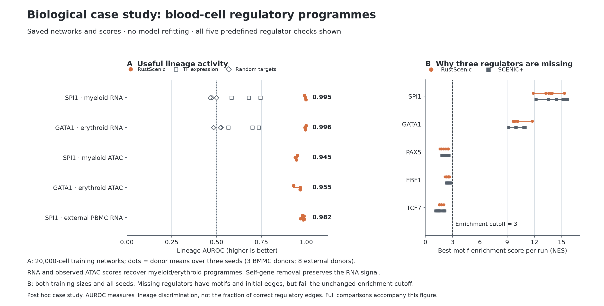

# Biological case study: recovering blood-cell regulatory programmes

**RustScenic recovers reproducible myeloid and erythroid activity across donors,
with supporting chromatin-accessibility signal and external transfer of the
myeloid programme. Three other predefined regulators remain missing.**

[Independent Codex audit: passed](INDEPENDENT-AUDIT.md). The review caught and
verified a small tie-rounding correction in the new control calculation;
original activity scores and the RustScenic engine were unchanged.



## What a researcher can conclude

Networks fitted on 20,000 BMMC cells from seven donors were applied to 10,000
cells from three different donors. RustScenic's SPI1-associated programme is
more active in the predefined myeloid populations, and its GATA1-associated
programme is more active in erythroid populations. The direction repeats across
all three donors and all three inference seeds. Independent experiments support
the roles of [PU.1/SPI1 in myeloid development](https://pubmed.ncbi.nlm.nih.gov/9694804/)
and [GATA1 in erythroid differentiation](https://pmc.ncbi.nlm.nih.gov/articles/PMC316770/).
These references support the interpretation, not every inferred target or an
exclusive role for SPI1 in myeloid cells.

| Evidence | SPI1 / myeloid | GATA1 / erythroid |
| --- | ---: | ---: |
| Gene-activity AUROC, donor mean | 0.9951 | 0.9959 |
| Range of donor means | 0.9907–0.9989 | 0.9928–0.9995 |
| Observed-region activity AUROC | 0.9452 | 0.9545 |
| TF's own expression AUROC | 0.6696 | 0.6673 |
| Size-matched random-target AUROC | 0.4796 | 0.5100 |
| Gene activity after removing the TF's own gene | 0.9951 | 0.9959 |
| External PBMC gene-activity AUROC, eight donors | 0.9824 | No erythroid lineage sampled |

AUROC is the probability that a randomly selected target-lineage cell receives
a higher score than a non-target cell, counting ties as one half. It is not
classification accuracy or the fraction of correct regulatory edges. Algorithm
seeds are averaged within each donor, then donors receive equal weight. The
ranges above describe donor variation, not confidence intervals. Random
controls use five fixed target draws per signature and seed, preserving target
count and excluding the TF itself; they are not expression-matched controls.

The external cohort is 12,315 unstimulated Kang2018 PBMCs from eight donors.
Networks were not refitted there. External RustScenic scores are the returned,
corrected native scores; BMMC scores use the original shared AUCell scorer.
This table uses the original TF-union gene signatures. Signed endpoints and
all classification results remain in the main paper, unchanged.

Full SCENIC+ comparisons, the 5,000-cell sensitivity, all seeds, all five markers
and absent outputs are in [lineage-donor-results.csv](lineage-donor-results.csv).
At 20,000 training cells, SCENIC+ recovers SPI1 in two of three seeds and GATA1
in one; its conditional mean gene AUROCs are 0.9887 and 0.9962. Those conditional
means cannot be treated as complete three-seed comparisons with RustScenic.

## Why PAX5, EBF1 and TCF7 are missing

All three are present in the expression and TF panels, have annotated database
motifs and initial GRN edges, and have motif-hit regions in the selected panel.
An independent calculation reproduces the returned enrichment scores and
every accept/reject decision for the five markers. Their best motif enrichment
scores across all 30 topics, both training sizes, both methods and all seeds
remain below the unchanged NES cutoff of 3:

| Regulator | Database motifs | Best NES | Final recovery |
| --- | ---: | ---: | --- |
| PAX5 | 15 | 2.5872 | Missing in both workflows |
| EBF1 | 12 | 2.7605 | Missing in both workflows |
| TCF7 | 7 | 2.1304 | Missing in both workflows |

This identifies the stage and numerical reason for loss. It rules out missing
IDs, missing database motifs and the AUCell scoring bug as explanations for
these absences. It does not establish why the chosen topic/region recipe fails
to enrich those motifs, or explain the Rust-specific common-TF macro-F1 deficit:
these three regulators are absent from both methods. Broad top-1,000 topic
regions and the selected accessibility panel remain possible causes, not
confirmed defects. No threshold was lowered and no marker was forced into a
network. See [regulator-trace.csv](regulator-trace.csv).

The saved topic models do capture B-cell and naive-T-cell structure. Across
both methods and all runs, the best of 30 topics has training-cell lineage
AUROC 0.976–0.994 for B cells and 0.931–0.971 for naive T cells. These topics
still do not enrich the missing regulators' motifs above 3. This is a
label-guided, post hoc training diagnostic, not held-out predictive performance
or proof of a particular TF programme. All 30 topic results are retained in
[training-topic-lineage.csv](training-topic-lineage.csv). It narrows the issue
beyond simply failing to represent those cell populations.

## Scope and next decision

This is a post hoc case study of known lineage programmes on already inspected
cohorts. RNA-derived cell labels, motif plausibility and observed ATAC agreement
do not independently validate causal links, disease responses or new discoveries.
The original negative results, including the macro-F1 gap and weak experimental
edge recovery, remain in the paper. The case supports a practical use of the
software without establishing universal biological equivalence.

No new engine defect was confirmed. The verified native scoring fix is retained;
runtime kernels, defaults and the measured performance claims are unchanged.
Any future region-selection change should be justified on training data and
confirmed on an untouched cohort before it becomes an accuracy claim. It is
not required to present this scoped case study.

## Reproduce and inspect

From the repository root, with the existing dated archives extracted beneath
`/path/to/RustScenic`:

```bash
python validation/biological_case_study/trace.py \
  --package /path/to/RustScenic/RustScenic-Paper-Validation-20261106/rustscenic-paper-validation \
  --returned /path/to/RustScenic/RustScenic-Biology-Results-Audit-20261106/returned \
  --output docs/paper/case-study
python validation/biological_case_study/case_study.py \
  --root /path/to/RustScenic --output docs/paper/case-study
python validation/biological_case_study/figure.py docs/paper/case-study
python -m pytest validation/biological_case_study/test_case_study.py -q
```

The figure can be rebuilt from the included CSVs alone. Small per-cell marker
scores and cell labels are included in `lineage-activity-source.parquet` for
independent reanalysis. Full source paths and SHA256 hashes are in the two
verification JSON files. Full reanalysis also uses the 6 November BMMC return,
7 November confirmation package and return, 7 November biological-fidelity
rank cache, and 8 November corrected-scoring return. The rank cache is checked
against every original expression row before use. No network, topic or
classifier fitting is performed.

Dependencies used for this case study: Python 3.13.9, NumPy 2.3.5, pandas 2.3.3,
SciPy, scikit-learn, h5py, pyarrow and matplotlib 3.10.8. It runs without SCENIC+
or a RustScenic installation because it reuses saved outputs.

The trace decodes each authentic rank block and checks its original hash. It
uses sparse rank contributions, avoiding a dense 5,876 × 42,337 ranking matrix.
The package-level hot-path audit and existing stage timings are recorded in
[performance-review.json](performance-review.json). No new whole-workflow
speed or memory improvement is claimed.
