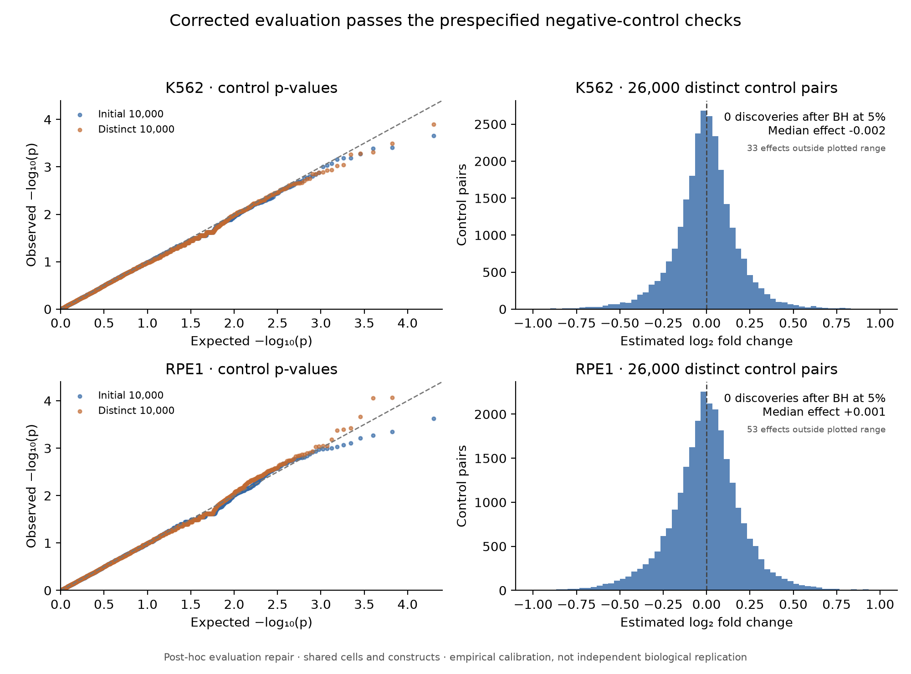
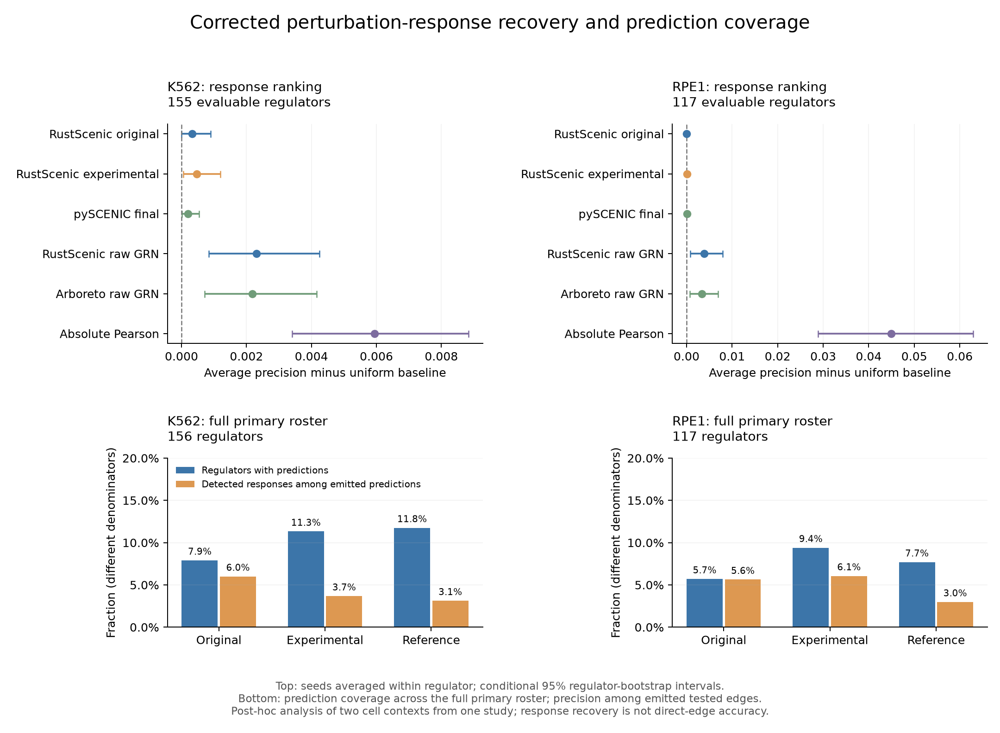

# RustScenic: corrected evaluation and publication claims

12 November 2026. Local analysis, not sent or published. All six frozen network
sets were reused; no network refit, recipe selection or production-default change.

**The response evaluator has been repaired and empirically calibrated. This
does not make a fixed percentage of RustScenic edges biologically correct.**
The tables below measure recovery of expression responses to perturbations,
including indirect effects, within selected gene panels. They must be read with
coverage and power. This is a post-hoc re-analysis of two cell contexts from one
study, not a fresh independent confirmation.

**Publication conclusion: the evidence supports a scalable software workflow
with useful lineage activity signals and limited perturbation-response recovery.
It does not establish a broadly more accurate regulatory network.**

Primary AP scores (155 K562 and 117 RPE1 rank-evaluable regulators):

| Context | RustScenic original | Experimental | pySCENIC final | Absolute Pearson | Tied baseline |
| --- | --- | --- | --- | --- | --- |
| K562 | 0.023722 | 0.023862 | 0.023590 | 0.029339 | 0.023398 |
| RPE1 | 0.052176 | 0.052241 | 0.052213 | 0.097099 | 0.052139 |

The experimental-minus-original AP gain is +0.000140 in K562 (conditional 95%
TF-bootstrap interval +0.000017 to +0.000322) and +0.000064 in RPE1
(−0.000003 to +0.000186). These are small absolute differences; the RPE1
interval includes zero. Pearson exceeds both final RustScenic recipes in both
contexts, at all three effect thresholds and on all three reported rosters.

Mean primary-roster coverage rises from 12.33 to 17.67 of 156 K562 regulators
and from 6.67 to 11.00 of 117 RPE1 regulators. Pooled response precision among
emitted tested top-50 predictions falls from 6.00% to 3.67% in K562 and rises
from 5.63% to 6.06% in RPE1. At the matched emitted budget, mean per-TF precision
falls in both contexts (3.03% to 2.92%, and 8.56% to 5.93%), on only 17/13
represented TFs. More nominations therefore do not establish a general accuracy
upgrade. These precision values are conditional benchmark response recovery,
not the percentage of biologically correct regulatory edges.

The rerun produced 2,120,690 finite QC-passing tests and 26,922 ranking rows.
Six regression tests, independent R multiple-testing checks, 2,037 independently
recomputed real-network AP rows, 126 macro summaries and 144 paired intervals
passed verification. No model refits or default changes were made.

## What was wrong and what changed

The previous evaluator logged small capture-level CPM pools before averaging.
In negative-control partitions, its primary threshold labelled 52.76% of eligible
K562 panel genes and 64.04% of RPE1 panel genes as responses, all downward.
Those old response scores are retained in the original audit, but cannot support
an accuracy claim. A pooling-before-log diagnostic isolated the bias; it did not
by itself establish statistical error control.
Old and corrected AP values are not directly comparable as a performance change:
the response definition, eligible pair universe and response prevalence changed.

The replacement uses unmodified SCEPTRE 0.99.1, commit
`20c33349c2c5a0df66589e37f67238e67c53bcb0`, on the exact held-out raw counts.
It uses low-MOI negative-control-cell comparisons, two-sided permutation tests,
the default skew-normal approximation, log full-source library size and capture
batch adjustment. Existing assigned guide-pair constructs are binary assignment
indicators, not measured guide UMI counts. The original training/evaluation split
and 5,000-gene panels are unchanged. Pairwise QC requires at least seven nonzero
treatment and control cells; failed pairs are unavailable, not negatives.
This QC can exclude truly strongly suppressed genes, so measured performance
is conditional on the tested gene universe.

BH correction is applied across finite QC-passing tests within each cell line.
The primary benchmark response additionally requires an absolute log2 fold
change of at least 0.5; 0.25 and 1.0 sensitivities are retained. The effect filter is an additional
benchmark definition, not a separate guarantee of 5% FDR for the filtered subset.
Self-targets are assessed separately and excluded from network ranking.
Gene-response ranking is unsigned: a response in either direction counts, so
this endpoint does not validate an inferred activator/repressor sign.

The [hashed analysis plan](RECALIBRATION-PLAN.md) preceded corrected comparisons.
The [sampling amendment](CALIBRATION-AMENDMENT.md) records that SCEPTRE's C++
sampler fixes its seed: the initial repeat was identical and counted once.
An additional 10,000 previously uncounted pairs per cell line supplied the second
check. Shared cells and constructs do not constitute independent replication.

## Calibration and power

All eight distinct control checks passed the prewritten operational gates.
There were zero BH 5% discoveries across 52,000 distinct negative-control pairs.
This is reassuring empirical calibration on these controls, not proof of
universal error control or 100% biological accuracy.

| dataset | run | tests | finite_tests | nominal_p05 | BH_discoveries | median_log2_effect |
| --- | --- | --- | --- | --- | --- | --- |
| k562 | median-a | 10000 | 10000 | 0.046500 | 0 | -0.003996 |
| k562 | validation | 10000 | 10000 | 0.044600 | 0 | -0.004508 |
| k562 | single | 3000 | 3000 | 0.054000 | 0 | 0.020045 |
| k562 | upper | 3000 | 3000 | 0.048000 | 0 | -0.000633 |
| rpe1 | median-a | 10000 | 10000 | 0.050300 | 0 | -0.001985 |
| rpe1 | validation | 10000 | 10000 | 0.047300 | 0 | 0.002655 |
| rpe1 | single | 3000 | 3000 | 0.049000 | 0 | 0.027236 |
| rpe1 | upper | 3000 | 3000 | 0.047000 | 0 | -0.003327 |

Intended target-gene reduction provides a separate positive-control check:

| dataset | total_targeted_TFs | self_gene_in_panel | self_QC_pass | significant_down | adequate_KD | median_eligible_log2_effect |
| --- | --- | --- | --- | --- | --- | --- |
| k562 | 202 | 172 | 122 | 117 | 116 | -1.980776 |
| rpe1 | 245 | 189 | 66 | 59 | 59 | -2.042000 |

The secondary adequate-knockdown subgroup requires own-target BH q <= 0.05
and estimated log2 fold change <= −0.25, in addition to pairwise QC.

All own-target QC failures were below the treatment detection threshold. Strong
knockdown can itself make an own-target pair fail that threshold; QC failure must
not be interpreted as ineffective perturbation. Conversely, successful own-target
knockdown does not establish downstream prediction accuracy.

The primary control groups approximate typical target sample sizes. Actual
median calibration treatment counts were 106–107 versus 114 targeted cells in
K562 and 85 versus 72 in RPE1. Discovery sample sizes are heterogeneous, up to
992 and 3,580 cells. The checks cover single, typical and upper-quantile construct
groups; they do not exactly match every extreme target. Full distributions are
in [control-sample-sizes.csv](summary/control-sample-sizes.csv).

## Corrected response coverage

The primary roster preserves the original 156 K562 and 117 RPE1 eligible TFs.
All 202/245 assayed TFs remain in coverage and secondary tables. Ranking requires
both a response and a benchmark nonresponse; the number actually rank-evaluable
can therefore be smaller. Non-significant tested pairs may be underpowered.
The frozen regulator list includes cofactors and other non-DNA-binding proteins;
not every assayed regulator can be expected to yield a motif-supported signature.
Motif annotation and presence in the training predictor panel are shown separately.

| dataset | roster | targets | planned_pairs | eligible_pairs | significance_only_pairs | response_pairs | response_up | response_down | TFs_rank_evaluable | TFs_without_tested_pairs |
| --- | --- | --- | --- | --- | --- | --- | --- | --- | --- | --- |
| k562 | primary | 156 | 779871 | 778823 | 61151 | 18089 | 9749 | 8340 | 155 | 0 |
| k562 | all | 202 | 1009828 | 983005 | 67759 | 22335 | 12237 | 10098 | 199 | 2 |
| rpe1 | primary | 117 | 584917 | 583386 | 62003 | 30305 | 9082 | 21223 | 117 | 0 |
| rpe1 | all | 245 | 1224811 | 1137685 | 130474 | 84055 | 29518 | 54537 | 244 | 1 |

## Frozen-network performance

Equal-TF macro average precision (AP), after averaging three seeds within each
TF. AP is a ranking score, not percentage accuracy. The uniform tied baseline is
the mean response prevalence for exactly the same evaluable TFs and genes.
Every method retains missing network predictions as tied zero scores.

| dataset | method | TFs | average_precision | response_prevalence | emitted_hits50 | predictions50 | pooled_emitted_precision |
| --- | --- | --- | --- | --- | --- | --- | --- |
| k562 | diverse_importance | 155 | 0.023862 | 0.023398 | 0.131183 | 3.569892 | 0.036747 |
| k562 | full_pearson | 155 | 0.029339 | 0.023398 | 1.948387 | 41.290323 | 0.047188 |
| k562 | native_raw | 155 | 0.025712 | 0.023398 | 1.258065 | 41.290323 | 0.030469 |
| k562 | original | 155 | 0.023722 | 0.023398 | 0.068817 | 1.146237 | 0.060038 |
| k562 | reference | 155 | 0.023590 | 0.023398 | 0.116129 | 3.716129 | 0.031250 |
| k562 | reference_raw | 155 | 0.025577 | 0.023398 | 1.275269 | 41.290323 | 0.030885 |
| k562 | uniform | 155 | 0.023398 | 0.023398 | 0.000000 | 0.000000 | unavailable |
| rpe1 | diverse_importance | 117 | 0.052241 | 0.052139 | 0.102564 | 1.692308 | 0.060606 |
| rpe1 | full_pearson | 117 | 0.097099 | 0.052139 | 7.991453 | 35.470085 | 0.225301 |
| rpe1 | native_raw | 117 | 0.055976 | 0.052139 | 2.527066 | 35.470085 | 0.071245 |
| rpe1 | original | 117 | 0.052176 | 0.052139 | 0.034188 | 0.606838 | 0.056338 |
| rpe1 | reference | 117 | 0.052213 | 0.052139 | 0.056980 | 1.911681 | 0.029806 |
| rpe1 | reference_raw | 117 | 0.055504 | 0.052139 | 2.433048 | 35.470085 | 0.068594 |
| rpe1 | uniform | 117 | 0.052139 | 0.052139 | 0.000000 | 0.000000 | unavailable |

Conditional 95% intervals resample TFs 5,000 times after averaging seeds.
They do not measure donor replication, establish equivalence, or correct for
selecting among the reported methods, thresholds and subgroups.

| dataset | comparison | TFs | mean_AP_difference | TF_bootstrap_low | TF_bootstrap_high |
| --- | --- | --- | --- | --- | --- |
| k562 | diverse_importance minus original | 155 | 0.000140 | 0.000017 | 0.000322 |
| k562 | diverse_importance minus reference | 155 | 0.000272 | 0.000032 | 0.000674 |
| k562 | diverse_importance minus uniform | 155 | 0.000464 | 0.000053 | 0.001202 |
| k562 | diverse_importance minus full_pearson | 155 | -0.005477 | -0.008306 | -0.003022 |
| k562 | original minus reference | 155 | 0.000132 | -0.000012 | 0.000373 |
| k562 | original minus uniform | 155 | 0.000324 | 0.000006 | 0.000900 |
| k562 | original minus full_pearson | 155 | -0.005617 | -0.008481 | -0.003157 |
| k562 | native_raw minus reference_raw | 155 | 0.000135 | -0.000363 | 0.000618 |
| rpe1 | diverse_importance minus original | 117 | 0.000064 | -0.000003 | 0.000186 |
| rpe1 | diverse_importance minus reference | 117 | 0.000028 | -0.000011 | 0.000071 |
| rpe1 | diverse_importance minus uniform | 117 | 0.000102 | 0.000020 | 0.000239 |
| rpe1 | diverse_importance minus full_pearson | 117 | -0.044859 | -0.062823 | -0.028818 |
| rpe1 | original minus reference | 117 | -0.000037 | -0.000154 | 0.000037 |
| rpe1 | original minus uniform | 117 | 0.000037 | 0.000004 | 0.000082 |
| rpe1 | original minus full_pearson | 117 | -0.044923 | -0.062894 | -0.028864 |
| rpe1 | native_raw minus reference_raw | 117 | 0.000472 | -0.000026 | 0.001112 |

Emitted-edge precision concerns the small set of positive predictions actually
nominated within the top-50 budget. It is conditional response recovery, not
global edge precision. Expected top-50 hits, which include fractional credit
at zero-score ties, are retained separately in the machine-readable tables.
The AP table's precision is conditional on rank-evaluable TFs. The coverage
table below also reports all-primary-roster precision, retaining predictions
for tested TFs with no called response, so their nominated nonresponders are
not silently removed. Untested genes remain excluded from both denominators.

| dataset | method | roster_TFs | TFs_with_predictions | rank_evaluable_TFs | rank_evaluable_with_predictions | mean_eligible_edges | motif_and_predictor_available | all_roster_emitted_hits50 | all_roster_predictions50 | all_roster_pooled_precision |
| --- | --- | --- | --- | --- | --- | --- | --- | --- | --- | --- |
| k562 | diverse_importance | 156.000000 | 17.666667 | 155.000000 | 17.666667 | 4.844017 | 69.000000 | 0.130342 | 3.547009 | 0.036747 |
| k562 | original | 156.000000 | 12.333333 | 155.000000 | 12.333333 | 1.138889 | 69.000000 | 0.068376 | 1.138889 | 0.060038 |
| k562 | reference | 156.000000 | 18.333333 | 155.000000 | 18.333333 | 5.732906 | 69.000000 | 0.115385 | 3.692308 | 0.031250 |
| rpe1 | diverse_importance | 117.000000 | 11.000000 | 117.000000 | 11.000000 | 1.965812 | 48.000000 | 0.102564 | 1.692308 | 0.060606 |
| rpe1 | original | 117.000000 | 6.666667 | 117.000000 | 6.666667 | 0.606838 | 48.000000 | 0.034188 | 0.606838 | 0.056338 |
| rpe1 | reference | 117.000000 | 9.000000 | 117.000000 | 9.000000 | 2.259259 | 48.000000 | 0.056980 | 1.911681 | 0.029806 |

Matched-budget original versus experimental comparison, restricted to TF/seed
pairs where both methods emit predictions, then averaged within TF:

| dataset | threshold | TFs | original_precision | experimental_precision | original_hits | experimental_hits |
| --- | --- | --- | --- | --- | --- | --- |
| k562 | 0.500000 | 17 | 0.030333 | 0.029200 | 0.627451 | 0.676471 |
| rpe1 | 0.500000 | 13 | 0.085574 | 0.059311 | 0.717949 | 0.538462 |

This selected matched-budget subset cannot replace the all-regulator comparison.
All thresholds, the full assayed roster and the corrected adequate-knockdown
subgroup are retained in [macro-metrics.csv](summary/macro-metrics.csv) and
[paired-differences.csv](summary/paired-differences.csv). The adequate-knockdown
subgroup is conditional on an outcome-dependent power check and is secondary.

## Activity and computational evidence

The earlier activity endpoint does not depend on the faulty gene-response labels.
Its 2,457 rows were independently replayed from returned AUCell group means and
checked again here. Per-cell AUCell was not recomputed. Low support remains
visible; this descriptive secondary result is not broad biological superiority.

| dataset | method | reciprocal_rank | top10_credit | supported | both_halves_expected_direction |
| --- | --- | --- | --- | --- | --- |
| k562 | diverse_importance | 0.010054 | 0.021368 | 0.111111 | 0.051282 |
| k562 | original | 0.004809 | 0.014957 | 0.076923 | 0.034188 |
| k562 | reference | 0.006799 | 0.008547 | 0.117521 | 0.029915 |
| rpe1 | diverse_importance | 0.008707 | 0.017094 | 0.094017 | 0.042735 |
| rpe1 | original | 0.001824 | 0.005698 | 0.056980 | 0.022792 |
| rpe1 | reference | 0.005954 | 0.014245 | 0.076923 | 0.025641 |

The response-label defect does not invalidate the saved execution measurements.
Mean costs across three seeds on the same allocated nodes:

| dataset | method | inference_s | process_wall_s | peak_pss_gb |
| --- | --- | --- | --- | --- |
| k562 | native | 32.984839 | 160.057102 | 1.459790 |
| k562 | reference | 1219.848570 | 1354.353067 | 6.714232 |
| rpe1 | native | 34.142302 | 180.168691 | 1.446885 |
| rpe1 | reference | 1146.121097 | 1277.400992 | 6.844067 |

Native process time includes both refinements and an additional Pearson
diagnostic. These are configured-workload costs, not universal or biologically
quality-matched speedups. No evaluation runtime is substituted for inference
runtime.

## What the publication can claim

| Claim | Evidence and boundary |
| --- | --- |
| RustScenic enables lower-cost atlas-scale SCENIC-style analysis on the tested configurations | Retain the verified runtime/memory results with exact feature panels, hardware, algorithm differences and versions. The replicated comparator grid belongs to v0.5.0. Separate one-seed v0.6.1 confirmations completed 1,306,127-cell RNA and 817,740-cell paired workflows in 40.78/104.35 minutes at 4.66/44.00 GB sampled peak PSS. Do not combine stages into a new synthetic speedup. |
| Frozen activity signatures recover useful lineage programmes | Independently audited held-out BMMC SPI1/GATA1 gene-activity AUROCs were 0.995057/0.995897, with random-signature means 0.479593/0.509962 and preserved signal after self-removal. External SPI1 union AUROC was 0.982360. These quantify lineage discrimination, not regulatory-edge truth. |
| Perturbation-response recovery was evaluated using an empirically calibrated, count-aware analysis | Report the corrected scores, power, QC exclusions, coverage, baselines and all thresholds above. Call this post-hoc re-analysis of K562/RPE1 from one study. |
| A percentage of inferred regulatory edges is biologically correct | Not established. Expression responses can be indirect; uncalled pairs can be underpowered. No single accuracy percentage is justified. |
| The experimental recipe is a generally more accurate replacement | Not established by this inspected study alone. Any context-specific differences must retain their magnitude, intervals, coverage and secondary-analysis status. Do not promote the recipe from these data. |
| Biological noninferiority, equivalence, superior causal edges or enhancer-to-gene accuracy | Not established. These require an appropriate fixed claim, evaluation design and independent confirmation; direct enhancer-link claims need relevant functional evidence. |
| Ready for submission with no remaining work | Not yet. Preserve and durably deposit the evidence, resolve retained HPC outputs, complete coauthor review and required authorship/data/disclosure statements, and align the manuscript with the actual claim. Journal acceptance is not guaranteed by a testing checklist. |

The defensible paper is a software and scalability contribution with useful
activity examples and transparent biological limitations. Additional broad atlas
scaling does not resolve biological accuracy. A future stronger method claim
would need designated development data and an untouched confirmation after the
method and evaluator are fixed.

Retain the adverse activity results too: PAX5, EBF1 and TCF7 lacked final
motif-supported signatures in both workflows. In the reused external donor
comparison, separate-direction activity achieved macro-F1 0.712332 versus
0.711258 for SCENIC+ signatures, while mean cell-type recall remained lower,
0.782637 versus 0.797620. Neither the close F1 values nor the strong selected
lineage AUROCs establish general biological equivalence.

The earlier Norman2019 capture-half response endpoint remains historical,
uncalibrated evidence. This repair directly calibrates the Replogle K562/RPE1
analysis; it does not retroactively validate that earlier heuristic or revise
its preserved numerical results.

## Verification and reproducibility

- Raw-source hashes, barcode/guide/capture axes, aggregate counts and disjoint
  training/evaluation cells verified before modelling.
- All six saved prediction sets, package/protocol inputs and Pearson axes
  rechecked against frozen receipts; no fitting or recipe changes.
- Regression checks cover the original pooling bias, BH adjustment,
  QC/missingness, self-exclusion, score ties and absent predictions.
- Python q-values match independent R `p.adjust`; R also checks SCEPTRE's
  discovery flags. All summary means and TF-bootstrap intervals reconstruct
  from the saved per-TF tables.
- Control calibration, positive-control coverage, all thresholds and adverse
  results are retained. The official SCEPTRE source tree is unchanged.

See [VERIFICATION.json](VERIFICATION.json), [reproduction instructions](REPRODUCE.md),
[implementation notes](IMPLEMENTATION-NOTES.md), and the machine-readable tables
in `summary/`. The calibration figure was inspected visually.

Original package SHA-256:
`1a28d4a5223871fa27784856ce2f645545180fe8bf164bab93fcc5362cd70e3d`.
Returned archive SHA-256:
`a70c9bc521f439a637d17bb0ca209bda3783afe42a172fd92d57d73baf2b1d07`.

Primary method sources: [SCEPTRE documentation](https://katsevich-lab.github.io/sceptre/),
[Barry et al., Genome Biology 2024](https://doi.org/10.1186/s13059-024-03254-2).
Data source: [Replogle et al., Cell 2022](https://doi.org/10.1016/j.cell.2022.05.013).
