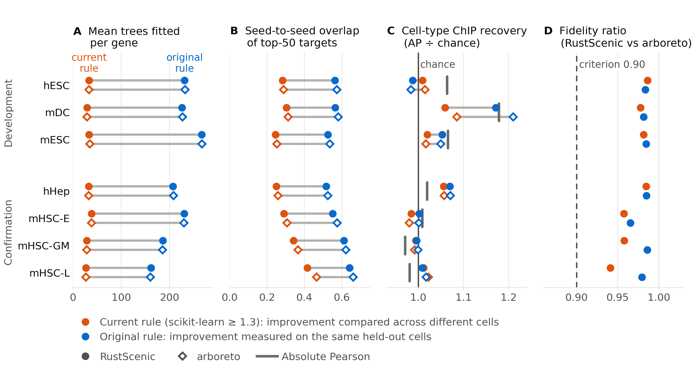

# RustScenic biological validation: what was wrong and what fixes it

12 November 2026, with a real scikit-learn 1.2.2 check added on 13 November.
Local analysis. Production defaults are
unchanged. Development and confirmation results are kept apart.

**Update, 19 November 2026.** The independent HPC replication at 20,000 cells
returned: 8 of 12 pre-specified checks met. Trees and stability gains held, and
both recovery rules were met, but fidelity to pySCENIC failed in three of four
tests because RustScenic 0.6 quantised TF expression into 255 bins. Exact
binning, now the default on branch `exp/finer-bins`, restores it (0.949 to 0.985,
post hoc). The original rule costs 28 times the GRN time at 1.31 million cells.
See the [replication evidence](../stopping-rule-minerva/README.md). The
BEELINE agreement results below hold for those small datasets only.

## Answer

The weak biology in the manuscript has three separate causes. Only the first is
a method problem, and it is fixable.

1. **GRNBoost2 is being stopped almost immediately, in pySCENIC and in
   RustScenic.** scikit-learn 1.3 changed the quantity arboreto's stopping rule
   reads. Since then the rule fires at a median of 25 to 30 trees per gene
   whatever the signal. Restoring the original definition trains six to eight
   times longer and roughly doubles seed-to-seed reproducibility. This was
   confirmed on four untouched datasets against criteria fixed in advance. On
   broader experimental references it lifts the network from below Pearson to
   level with or above it in most cases. RustScenic now offers it as
   `early_stop_mode="paired_oob"`.
2. **The Replogle perturbation benchmark does not measure what the paper says it
   measures.** Networks were trained on unperturbed control cells of one cell
   line, which carry almost no regulatory variation, and the response labels are
   dominated by genes that respond to many knockdowns. A score with no network
   in it beats Pearson by 2.8 times in K562 and 1.7 times in RPE1.
3. **The lineage failures came from the benchmark configuration.** PAX5 and
   EBF1 were reported lost. A standard RNA run on the same bone-marrow data
   recovers both with held-out-donor AUROC above 0.97.

RustScenic and pySCENIC agree with each other as closely as pySCENIC agrees with
itself across seeds, under both stopping rules.

## 1. The stopping rule

### Mechanism

arboreto stops boosting a target gene when the mean of the last 25 values of
scikit-learn's `oob_improvement_` is negative.

| scikit-learn | `oob_improvement_[i]` | Source |
| --- | --- | --- |
| up to 1.2.2 | loss before round i minus loss after round i, both on round i's out-of-bag cells | `old_oob_score - loss_(y[~sample_mask], ...)` |
| 1.3 onwards | previous round's out-of-bag loss minus this round's, measured on two different random 10% subsets | `previous_loss = ... self.oob_scores_[i - 1]` |

Under the new definition the 25-value mean telescopes to (loss 25 rounds ago on
one subset) minus (loss now on another subset), divided by 25. That compares two
unrelated subsets, so sampling noise decides the outcome: in the 20,000- to
1,306,127-cell replication runs, 19% to 44% of genes stopped at the minimum of
25 trees under the current rule. Checked directly in the 1.2.2 and 1.3.2 sources.
The 1.3 changelog lists only the new `oob_scores_` attribute. Two web searches
found no report of the effect on arboreto or pySCENIC.

RustScenic reproduced the new behaviour deliberately in August to match its
reference (`validation/parity_v0310/ISSUE_95_EARLY_STOP_2026-08-14.md`).

### Evidence that both tools are affected

Fitted trees per target gene, from saved runs (5,000-tree ceiling, 25 is the
minimum the rule allows):

| Data | pySCENIC (arboreto, scikit-learn 1.3.2) | RustScenic |
| --- | --- | --- |
| K562 controls, 8,534 cells | mean 26.3, median 25 | mean 26.4, median 26 |
| RPE1 controls, 9,169 cells | mean 27.1, median 26 | mean 27.2, median 26 |
| Bone marrow, 20,000 cells, 22 cell types | not run | mean 28.4, median 26 |
| PBMC3k (August note) | mean 26.5, median 26 | mean 26.4, median 26 |

Real arboreto with real scikit-learn trees, same data, only the monitor changed
to the same-mask definition: a median of 228 trees against 29 on 24 hESC genes.

### SCENIC+ is affected in its TF-to-gene step (16 November)

`scenicplus/TF_to_gene.py` imports `infer_partial_network`, `SGBM_KWARGS` and
`EARLY_STOP_WINDOW_LENGTH` from `arboreto.core` and calls
`infer_partial_network('GBM', SGBM_KWARGS, ..., early_stop_window_length=EARLY_STOP_WINDOW_LENGTH)`
for every target gene, which is exactly the GRNBoost2 call. Checked in
scenicplus 1.0a2 (the version in the paper's comparator environment, with
arboreto 0.1.6 and scikit-learn 1.3.2) and on the current upstream main branch
(commit 840dab8, 16 January 2026). The TF-to-gene importances behind SCENIC+
eRegulons are therefore truncated in the same way on scikit-learn 1.3 or later.

Region-to-gene is not affected: `enhancer_to_gene.py` defaults to
`GradientBoostingRegressor` with `GBM_KWARGS` (500 trees, no `subsample`), and
arboreto's `is_oob_heuristic_supported` requires `subsample < 1`, so no
stopping monitor is attached. RustScenic's enhancer links do not use boosting.

### Development (hESC, mDC, mESC: previously inspected)

Same data, settings, seeds (777, 778, 779) and metric as the manuscript. Arrows
run from the current rule to the original rule.

| Dataset | Trees per gene, RustScenic | Trees per gene, pySCENIC | Seed overlap, RustScenic | Seed overlap, pySCENIC | Agreement ratio, current / original rule |
| --- | --- | --- | --- | --- | --- |
| hESC | 33.7 → 231.2 | 33.4 → 232.0 | 0.283 → 0.563 | 0.288 → 0.573 | 0.986 / 0.983 |
| mDC | 29.4 → 225.7 | 29.4 → 226.9 | 0.304 → 0.565 | 0.312 → 0.580 | 0.978 / 0.982 |
| mESC | 33.5 → 266.7 | 34.9 → 267.0 | 0.245 → 0.526 | 0.252 → 0.535 | 0.981 / 0.985 |

"Seed overlap" is the mean per-TF Jaccard of the top-50 targets between seeds.
"Agreement ratio" is RustScenic-versus-pySCENIC overlap divided by pySCENIC
seed-versus-seed overlap: 1.0 means swapping the implementation changes the
network no more than changing pySCENIC's seed.

| Dataset, reference | RustScenic AP, current → original | Difference (95% interval) | pySCENIC difference | Pearson AP |
| --- | --- | --- | --- | --- |
| hESC, ChIP | 0.1487 → 0.1454 | −0.0033 (−0.0111 to +0.0043) | −0.0046 (−0.0128 to +0.0027) | 0.1566 |
| mDC, ChIP | 0.0488 → 0.0540 | +0.0052 (−0.0015 to +0.0157) | +0.0057 (−0.0014 to +0.0137) | 0.0543 |
| mESC, ChIP | 0.2964 → 0.3059 | +0.0096 (+0.0006 to +0.0187) | +0.0096 (+0.0007 to +0.0188) | 0.3096 |
| mESC, perturbation | 0.1364 → 0.1506 | +0.0142 (+0.0021 to +0.0262) | +0.0135 (+0.0013 to +0.0256) | 0.1502 |

| Dataset | Regulons | Regulon identity overlap between seeds | Target overlap within shared regulons |
| --- | --- | --- | --- |
| hESC | 100 → 98 | 0.410 → 0.498 | 0.273 → 0.452 |
| mDC | 41 → 54 | 0.590 → 0.772 | 0.325 → 0.490 |
| mESC | 178 → 201 | 0.480 → 0.631 | 0.234 → 0.422 |

### Confirmation (hHep, mHSC-E, mHSC-GM, mHSC-L: never used before)

The protocol and its pass criteria were hashed at 21:01 UTC, before these
datasets were staged ([protocol](CONFIRMATION-PROTOCOL.md),
[freeze record](CONFIRMATION-FREEZE.json), [run log](runs/beeline-confirmation-RUNLOG.md)).
The three mHSC lineages share one study and one reference and count as one
family.

| Pre-set endpoint | Criterion | Result | Verdict |
| --- | --- | --- | --- |
| Training length | Trees ratio at least 3, all four, both tools | RustScenic 6.3, 6.0, 6.5, 6.0; pySCENIC 6.4, 6.0, 6.5, 5.9 | Confirmed |
| Seed stability | Higher in all four, mean ratio at least 1.5 | 2.07, 1.90, 1.80, 1.54; mean 1.83 | Confirmed |
| Implementation fidelity | Agreement ratio at least 0.90, all four, both rules | Current rule 0.941 to 0.984; original rule 0.965 to 0.986 | Confirmed |
| Cell-type ChIP recovery | Positive in both families for an overall claim; per-dataset claim only if the interval excludes zero | hHep +0.0048; mHSC mean +0.0031; no interval excludes zero | Direction met, magnitude small |

| Dataset | Trees per gene, RustScenic | Trees per gene, pySCENIC | Seed overlap, RustScenic | Seed overlap, pySCENIC | Agreement ratio, current / original rule |
| --- | --- | --- | --- | --- | --- |
| hHep | 32.9 → 207.1 | 32.7 → 208.6 | 0.250 → 0.516 | 0.258 → 0.525 | 0.984 / 0.985 |
| mHSC-E | 38.7 → 230.6 | 38.5 → 230.2 | 0.290 → 0.551 | 0.307 → 0.575 | 0.958 / 0.965 |
| mHSC-GM | 28.6 → 186.1 | 28.5 → 185.7 | 0.341 → 0.612 | 0.365 → 0.621 | 0.958 / 0.986 |
| mHSC-L | 27.1 → 161.8 | 27.1 → 160.4 | 0.416 → 0.642 | 0.464 → 0.661 | 0.941 / 0.979 |

| Dataset, primary reference | RustScenic AP, current → original | Difference (95% interval) | pySCENIC difference | Pearson AP |
| --- | --- | --- | --- | --- |
| hHep, HepG2 ChIP | 0.3694 → 0.3742 | +0.0048 (−0.0066 to +0.0163) | +0.0048 (−0.0072 to +0.0164) | 0.3566 |
| mHSC-E, mHSC ChIP | 0.5525 → 0.5623 | +0.0098 (−0.0039 to +0.0212) | +0.0117 (−0.0020 to +0.0236) | 0.5662 |
| mHSC-GM, mHSC ChIP | 0.5731 → 0.5742 | +0.0011 (−0.0111 to +0.0107) | +0.0043 (−0.0098 to +0.0152) | 0.5593 |
| mHSC-L, mHSC ChIP | 0.4811 → 0.4796 | −0.0015 (−0.0098 to +0.0047) | −0.0022 (−0.0200 to +0.0126) | 0.4663 |

Cell-type-specific ChIP barely separates any method from chance on these panels
(AP 0.98 to 1.07 times prevalence), so this endpoint has little power. The
honest reading is no loss and a small, directionally consistent gain. It is not
evidence of a meaningful accuracy improvement on its own.

Secondary references, AP divided by chance. The freeze record fixed no
intervals for these. They were added on 16 November, after the results were
known, with the same TF-bootstrap (2,000 draws, seed 20261112;
`results/beeline-confirmation-all-intervals/ap-differences.csv`, which also
reproduces the cell-type intervals above to 2e-16). Original minus current rule,
95% interval: RustScenic excludes zero in seven of eight pairs (all four STRING;
non-specific ChIP in mHSC-E +0.0103 (+0.0040 to +0.0202), mHSC-GM +0.0119
(+0.0039 to +0.0253) and mHSC-L +0.0106 (+0.0019 to +0.0291), but not hHep +0.0007
(−0.0004 to +0.0024)); arboreto likewise seven of eight, with the same exception.
Against Pearson, RustScenic's interval lies entirely below zero in three pairs
under the current rule (hHep STRING, mHSC-GM both) and in one under the original
rule (mHSC-GM STRING).

Post hoc pooled cell-type ChIP difference over the four datasets
(`pooled_recovery.py`, same draws, `pooled-ap-differences.csv`): RustScenic
+0.0036 (−0.0025 to +0.0084), arboreto +0.0047 (−0.0030 to +0.0103); weighting the
mHSC family as one dataset gives +0.0040 (−0.0031 to +0.0102) and +0.0047
(−0.0031 to +0.0112). Still no evidence of a cell-type ChIP gain, and any loss is
bounded at about 0.003 AP.

| Dataset | Reference | RustScenic, current → original | pySCENIC, current → original | Pearson |
| --- | --- | --- | --- | --- |
| hHep | Non-specific ChIP | 1.07 → 1.12 | 1.07 → 1.11 | 1.09 |
| hHep | STRING | 1.58 → 1.84 | 1.57 → 1.87 | 1.83 |
| mHSC-E | Non-specific ChIP | 1.93 → 2.66 | 2.01 → 2.70 | 2.33 |
| mHSC-E | STRING | 3.53 → 4.82 | 3.63 → 4.77 | 4.52 |
| mHSC-GM | Non-specific ChIP | 2.98 → 3.81 | 2.83 → 3.74 | 4.80 |
| mHSC-GM | STRING | 6.74 → 8.55 | 6.99 → 8.57 | 13.77 |
| mHSC-L | Non-specific ChIP | 2.45 → 3.20 | 2.28 → 3.26 | 2.92 |
| mHSC-L | STRING | 17.38 → 26.20 | 16.72 → 26.83 | 27.06 |

The original rule improved all eight, in both tools. Under the current rule the
network is below Pearson on all eight; under the original rule RustScenic is
above Pearson on five and below on three (both mHSC-GM references, and mHSC-L
STRING by a small margin).

| Dataset | Regulons | Regulon identity overlap between seeds | Target overlap within shared regulons |
| --- | --- | --- | --- |
| hHep | 103 → 113 | 0.449 → 0.551 | 0.235 → 0.395 |
| mHSC-E | 69 → 70 | 0.589 → 0.623 | 0.291 → 0.474 |
| mHSC-GM | 44 → 49 | 0.627 → 0.782 | 0.364 → 0.579 |
| mHSC-L | 35 → 36 | 0.689 → 0.800 | 0.425 → 0.600 |

### A real scikit-learn 1.2.2 gives the same networks (13 November)

The pySCENIC original-rule arm above runs arboreto on scikit-learn 1.3.2 with a
monitor that recomputes the same-mask improvement. To test whether that is what
an old installation does, arboreto 0.1.6 was rerun with an unmodified
scikit-learn 1.2.2 wheel first on the import path and no patch: all seven
datasets, three seeds, same settings (`compare_sklearn122.py`,
[table](results/sklearn122-vs-emulated.csv)). This was added after the frozen
protocol and changes none of its endpoints.

All 21 networks are identical to the patched-monitor arm: the same number of
trees for every target, the same edges, and a largest importance difference of
exactly zero. The pySCENIC original-rule results in this report are therefore
what pySCENIC produces on scikit-learn 1.2.2, and the two pySCENIC arms differ
only in the scikit-learn version.

A small illustration, from the load test in the Minerva package (600 synthetic
cells, one target that is the sum of two regulators plus noise, same seed):
arboreto fits 1,180 trees on scikit-learn 1.2.2 and 28 on 1.3.2.

### Bone marrow, 5,000 cells, three seeds (development)

| | Current rule | Original rule |
| --- | ---: | ---: |
| Trees per gene | 26.8 | 181.4 |
| Seed overlap of top-50 targets | 0.339 | 0.578 |
| Motif-supported regulons | 210 | 258 |
| Regulons found in all three seeds | 118 | 163 |
| Regulon identity overlap between seeds | 0.515 | 0.588 |
| Target overlap within shared regulons | 0.285 | 0.457 |
| Lineage regulators (of 34) with an activating regulon in every seed | 15 | 17 |

PAX5 gets an activating regulon in none of three seeds under the current rule
and in all three under the original rule. Held-out-donor lineage AUROCs do not
change in any consistent direction (seed 777: median 0.914 against 0.906 across
18 regulators each; SPI1 fell from 0.876 to 0.740, PAX5 appeared at 0.984). On
this tissue the gain is reproducibility and yield, not sharper cell-type
separation.

### It is the adaptive rule, not just more trees

Fixed budgets with no stopping, development datasets, RustScenic:

| | Current rule (about 30 trees) | 100 trees | 250 trees | 500 trees | Original rule (about 230 to 270) |
| --- | ---: | ---: | ---: | ---: | ---: |
| Seed overlap, hESC | 0.283 | 0.473 | 0.610 | 0.674 | 0.563 |
| mDC ChIP AP | 0.0488 | 0.0511 | 0.0521 | 0.0518 | 0.0540 |
| mESC ChIP AP | 0.2964 | 0.2974 | 0.2980 | 0.2985 | 0.3059 |
| mESC perturbation AP | 0.1364 | 0.1422 | 0.1446 | 0.1449 | 0.1506 |

Stability keeps rising with trees, but recovery is best under the original
adaptive rule, which gives more trees to predictable genes and fewer to noisy
ones. Raising `n_estimators` alone does not reproduce it.

### Cost

Seconds per fit on a shared ten-core laptop, so indicative only.

| Dataset | RustScenic, current | RustScenic, original | pySCENIC, current | pySCENIC, original |
| --- | ---: | ---: | ---: | ---: |
| hESC | 2.3 | 15.4 | 28.7 | 154.7 |
| mDC | 1.0 | 7.8 | 8.5 | 38.4 |
| mESC | 3.1 | 24.7 | 38.2 | 302.5 |
| hHep | 2.0 | 10.7 | 15.0 | 154.7 |
| mHSC-E | 1.3 | 4.3 | 27.1 | 166.8 |
| mHSC-GM | 0.6 | 1.9 | 11.2 | 97.8 |
| mHSC-L | 0.3 | 0.8 | 4.9 | 34.6 |

RustScenic under the original rule is faster than pySCENIC under the truncated
one on all seven. On bone marrow at 5,000 cells the original rule cost about
seven times the current rule (136 to 975 seconds, contended). The multiplier at
atlas scale has not been measured and will be larger, because more cells make
the stopping test more sensitive.

## 2. The Replogle perturbation benchmark

Reanalysis of the saved calibrated labels and frozen networks. No refits for the
first two tables. Equal-TF macro average precision, primary rosters.

### The labels reward genes that respond to everything

| Score | K562 | RPE1 |
| --- | ---: | ---: |
| Uninformative | 0.0234 | 0.0521 |
| RustScenic raw importance | 0.0257 | 0.0560 |
| pySCENIC raw importance | 0.0256 | 0.0555 |
| Absolute Pearson | 0.0293 | 0.0971 |
| **No network: how often the gene responds to the other knockdowns** | **0.0811** | **0.1670** |

In RPE1, 777 of 5,000 genes respond to at least 10% of all knockdowns and hold
48% of all positives. Twenty knockdowns supply 65% (K562) and 66% (RPE1) of all
positives. Pearson's lead comes from this shared variation: across genes, mean
absolute correlation tracks responder frequency (Spearman 0.44 in RPE1).

Restricting positives to genes that respond to at most 5% of the other
knockdowns removes Pearson's advantage:

| Score, specific responses only | K562 | RPE1 |
| --- | ---: | ---: |
| Uninformative | 0.0163 | 0.0185 |
| Absolute Pearson | 0.0191 | 0.0200 |
| RustScenic raw importance | 0.0187 | 0.0201 |

### The training cells carry almost no signal

Networks were fitted to 8,534 (K562) and 9,169 (RPE1) unperturbed control cells.
TF-gene correlations there have a standard deviation of 0.023 and 0.034, against
0.011 and 0.010 expected from sampling noise alone.

Refitting RustScenic on knockdown cells of non-TF genes (disjoint from every
evaluation cell, same 5,000-gene panel, same labels) barely helps:

| K562 training cells | Raw importance AP | Pearson AP | Specific-response AP (importance / Pearson) |
| --- | ---: | ---: | --- |
| 8,534 controls | 0.0258 | 0.0293 | 0.0188 / 0.0191 |
| 8,534 non-TF knockdown cells | 0.0269 | 0.0297 | 0.0200 / 0.0199 |
| 50,000 non-TF knockdown cells | 0.0276 | 0.0300 | 0.0212 / 0.0200 |

The original stopping rule does not rescue it either (control cells, seed 777):

| | Trees per gene | Raw-importance AP | Pearson AP | Top-50 response precision (Pearson) | Specific-response AP (Pearson) | TFs with a regulon |
| --- | --- | --- | ---: | --- | --- | --- |
| K562 | 26 → 150 | 0.0258 → 0.0280 | 0.0293 | 3.1% → 4.1% (4.7%) | 0.0188 → 0.0188 (0.0191) | 21 → 27 |
| RPE1 | 27 → 225 | 0.0561 → 0.0629 | 0.0971 | 6.8% → 10.4% (22.5%) | 0.0199 → 0.0202 (0.0200) | 11 → 17 |

Conclusion: on this screen every coexpression method sits close to chance once
generic responders are handled, and the training population does not rescue it.
The result says little about RustScenic specifically. The manuscript should
report it as a characterised limitation of coexpression-based inference on
cell-line knockdown screens, with RustScenic and pySCENIC indistinguishable
(raw AP difference +0.0001 in K562 and +0.0005 in RPE1, intervals spanning zero),
and should stop presenting "Pearson performs better" without the generic-response
baseline beside it.

## 3. Lineage regulators in bone marrow

Standard RNA workflow (all 1,069 expressed TFs, gene-based motif rankings,
standard SCENIC module families), 20,000 training cells from seven donors,
activity scored on 10,000 cells from three held-out donors. The regulator's own
gene is removed from its regulon. One seed, development data.

| Regulator, lineage | 5,000-gene panel | 11,724 genes | Regulator's own expression | Random gene sets |
| --- | ---: | ---: | ---: | ---: |
| SPI1, myeloid | 0.801 | 0.993 | 0.666 | 0.49 to 0.52 |
| GATA1, erythroid | 0.969 | 0.969 | 0.650 | 0.50 to 0.54 |
| PAX5, B | 0.966 | 0.974 | 0.869 | 0.47 to 0.48 |
| EBF1, B | 0.976 | 0.989 | 0.907 | 0.51 |
| TCF7, T | no activating regulon | no activating regulon | 0.641 | |

Across 29 further textbook lineage regulators written down before scoring
(`lineage_regulators.json`), the full-transcriptome run produced regulons for 19
with median AUROC 0.942 (12 at or above 0.9); the 5,000-gene panel produced 17
with median 0.896 (7 at or above 0.9). The full run took 22 minutes and 2.2 GB
on a ten-core laptop.

The manuscript's statement that PAX5 and EBF1 are absent "in both workflows"
describes the restricted paired configuration (5,000 genes including 1,176 candidate TFs, 20,000 regions), not
RNA regulon inference. TCF7 remains a real gap: only a repressing regulon forms,
while LEF1, which shares its motif family, is recovered.

## 4. What the paper can now claim

| Claim | Status |
| --- | --- |
| scikit-learn 1.3 or later truncates GRNBoost2 at a median of 25 to 30 trees per gene in pySCENIC | Shown in source and in fitted-tree counts on eleven datasets, ten of them with real arboreto. On seven of them a real scikit-learn 1.2.2 was run side by side and trains six to eight times longer |
| Restoring the same-mask rule trains about six to eight times longer and roughly doubles seed reproducibility of networks | Confirmed on four untouched datasets against pre-set criteria, in both tools |
| Final regulons are more reproducible under the original rule | Seen in all seven datasets and in bone marrow; secondary endpoint |
| RustScenic and pySCENIC are interchangeable at the network level | Confirmed: agreement is 0.94 to 0.99 of pySCENIC's own seed-to-seed agreement under both rules; AP differences between tools span zero everywhere |
| The original rule improves recovery of experimental references | Small and not individually significant on cell-type ChIP; consistent on non-specific ChIP and STRING (eight of eight; post hoc intervals exclude zero in seven of eight). Say "no loss, consistent gain on broader references", not "more accurate" |
| RustScenic recovers canonical lineage regulators with a standard RNA configuration | Development result on bone marrow, one to three seeds; needs the pySCENIC arm and replication at scale |
| Better perturbation-response prediction | Not supported, and not expected from this benchmark. Report the generic-responder baseline |
| The atlas speed and memory results | Unchanged. They compare like for like under the current rule. The cost of the original rule at atlas scale is unmeasured |

## 5. What is left

1. **Scale.** The stopping-rule result is confirmed on datasets of 400 to 1,100
   cells and developed on 5,000 bone-marrow cells. It needs one Minerva round.
   The package was built and rehearsed locally on 13 November and run on
   Minerva by a collaborator (code in `../stopping-rule-minerva/package/`), and
   is designed to be the
   only round: bone marrow at 20,000 cells and the mouse brain atlas at 20,000
   cells with both tools and both rules, pySCENIC on a real scikit-learn 1.2.2,
   pySCENIC at 100,000 cells, and RustScenic up to all 1,306,127 atlas cells
   and on the 817,740-cell HDMA RNA matrix, which gives the original-rule cost
   of both headline benchmarks. Its protocol fixes twelve checks and two rules
   for recovery of broad reference links in advance. Complete networks are
   returned, so later analyses need no second round.
2. **Old scikit-learn for real.** Done locally on 13 November (section 1): a
   real scikit-learn 1.2.2 gives networks identical to the patched-monitor arm
   on all 21 fits. The Minerva package repeats it at scale.
3. **Perturbation evidence.** K562 and RPE1 under the original rule improve
   slightly and stay near chance (section 2). A perturbation benchmark that can
   separate methods would need training cells with real regulatory variation
   and labels corrected for generic responders. I would not commission one for
   this paper.
4. **Manuscript.** Add the stopping-rule section and figure, reframe the
   perturbation section, correct the PAX5 and EBF1 statement, and keep every
   existing limitation that still holds.

## 6. Reproducing this

Scripts are in this folder; inputs are the existing evidence folders beside it.
Environment: the patched build was an uncommitted working tree of v0.6.1 plus
one stopping mode (branch `fix/paired-oob-early-stop`), run in a local virtual
environment that reused the packages of the audited reference environment.
External inputs, the frozen dependencies (now in `frozen-dependencies/`) and the
expected layout are listed in [REPRODUCE.md](REPRODUCE.md).

| Step | Script | Output |
| --- | --- | --- |
| Label diagnosis | `diagnose_labels.py` | `diagnosis/` |
| Training-population refits | `stage_hetero.py`, package `fit.py`, `evaluate_fits.py` | `fits/k562-hetero*` |
| Bone marrow | `stage_bmmc.py`, `fit_variant.py`, `evaluate_bmmc.py`, `bmmc_stability.py` | `results/bmmc-*` |
| BEELINE arms | `beeline_arms.py` (one arm per process), `reference_paired.py` | `runs/beeline-*` |
| Real scikit-learn 1.2.2 | `beeline_arms.py` unmodified with the 1.2.2 wheel first on `PYTHONPATH`, then `compare_sklearn122.py` | `runs/beeline-sklearn122`, `results/sklearn122-vs-emulated.csv` |
| Scoring | `beeline_score.py`, `beeline_regulons.py` | `results/beeline-dev`, `results/beeline-confirmation` |
| Confirmation staging | `stage_confirmation.py` (28 October `prepare_inputs.py`, unchanged) | `inputs/beeline-confirmation` |
| Figure | `make_figure.py` | `results/figures/stopping-rule.*` |

Kernel checks: 6 of 6 `rustscenic-grn` boosting tests and 74 of 74 Python GRN
and CLI tests pass on the patched build. The default mode is unchanged, so
existing outputs and benchmarks are unaffected.

Sources: [scikit-learn 1.2.2 `_gb.py`](https://raw.githubusercontent.com/scikit-learn/scikit-learn/1.2.2/sklearn/ensemble/_gb.py),
[scikit-learn 1.3 release notes](https://scikit-learn.org/stable/whats_new/v1.3.html),
[scikit-learn PR 24882](https://github.com/scikit-learn/scikit-learn/pull/24882),
[GRNBoost2 and Arboreto, Bioinformatics 2019](https://academic.oup.com/bioinformatics/article/35/12/2159/5184284),
[BEELINE, Nature Methods 2020](https://doi.org/10.1038/s41592-019-0690-6).
