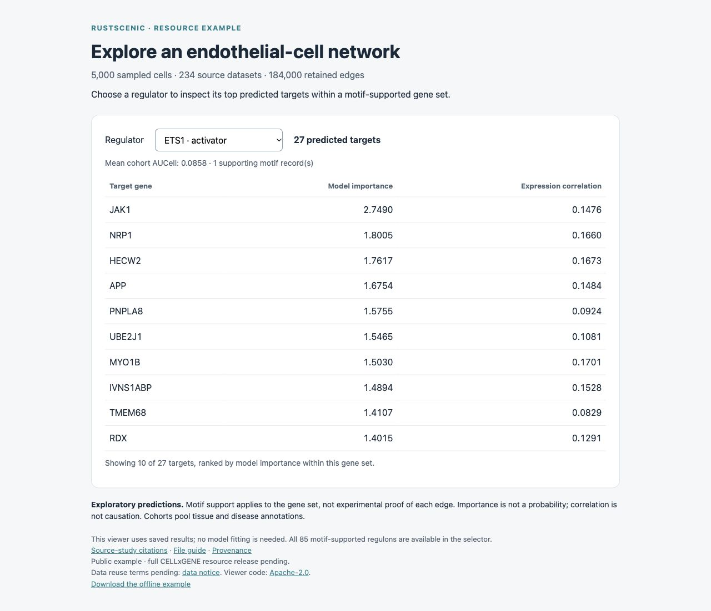

<div class="rustscenic-brand">
  
  <h1>RustScenic</h1>
</div>

**Fast gene regulatory network analysis for single-cell data.**

Infer candidate regulatory relationships and score their activity from RNA and
chromatin-accessibility data. Built in Rust, available through Python, and runs
on CPUs.

Created by Ekin Kahraman, developed and scaled with the Kuan-Lin Huang Lab at
the Icahn School of Medicine at Mount Sinai.

## Get started

Current release `v0.5.0`; Python **3.10–3.13**; Linux, macOS and Windows.

```bash
python -m pip install rustscenic
python -c "import rustscenic; print(rustscenic.__version__)"
```

Expected version: `0.5.0`.

[Run the PBMC3k example](https://github.com/Ekin-Kahraman/rustscenic/blob/main/QUICKSTART.md) ·
[Analyse your own data](quickstart.md) ·
[Explore a saved network](demo/endothelial/index.html) ·
[Installation options](installation.md)

Core analysis runs without Java, Dask, CUDA or Snakemake. The package supports
network inference, motif enrichment, activity scoring and multiome analysis.

## Performance and validation

| Evidence | Measured result and scope |
| --- | --- |
| RNA scale | **1,306,127 mouse-brain cells in 46m42s**, with 4.28 GB peak inference memory on 16 CPU cores; 2,095 selected genes and 256 TFs. |
| Matched arboreto comparison | **2.04–3.33× faster** on 20,000 cells; **81% lower physical memory** in the Intel-node comparison. |
| Memory scaling | **21.4% lower topic-model peak memory**, with unchanged outputs across three baseline and three optimised runs. Five sampling sweeps test storage, not model convergence. |
| Selected SCENIC+ stages | **`11x` to `52x` faster** on sampled real-data inputs of 1,500–2,000 cells. Enhancer methods differ; output agreement is incomplete. |
| Huang Lab collaborator run | **16/17 expected brain transcription factors** recovered on 8,215 post-QC cells with v0.4.6. A biological sanity check, not an accuracy estimate. |

The scale, arboreto and topic-memory results used the **v0.5.0 release candidate**.
The million-cell run measures inference on prepared RNA; separate preparation
took **7m18s** and peaked at **71.49 GB**. It does not establish a complete
million-cell spatial workflow. Each arboreto timing is one observation per
node, not a repeated-run average.

[Commands, hardware and output agreement](benchmarks.md) ·
[Biological checks and limitations](validation.md) ·
[Collaborator reports](adoption.md)

<details markdown="1">
<summary>Selected output-agreement results</summary>

| Check | Result |
| --- | --- |
| Human brain GEM-X 2k, including preparation | RustScenic **11.89 s**; SCENIC+ **150.36 s**. |
| GEM-X region-to-gene edge Jaccard | **1.000** under the fixed search space; scores are not identical. |
| GEM-X region AUCell mean Pearson | **0.823**. |
| cisTarget AUC kernel vs `ctxcore.recovery.aucs` | Pearson **1.0000**. |
| Remaining GEM-X differences | Gene AUCell Pearson **0.386**; eRegulon edge Jaccard **0.161**. |

[Full validation record](benchmarks.md#validation) ·
[Release and validation graphic](assets/rustscenic-evidence.svg)

</details>

## Explore a network

[Open the endothelial-cell example](demo/endothelial/index.html) to choose a
regulator and inspect its predicted targets. It uses saved results and needs
no installation or new model fitting.

[](demo/endothelial/index.html)

The example contains **184,000 retained edges**, **85 motif-supported regulons**,
activity summaries and source-study citations.
[Download it for offline use](https://raw.githubusercontent.com/Ekin-Kahraman/rustscenic/main/examples/cellxgene-endothelial/starter.zip).

The full collection covers **704 human Cell Ontology labels** from CELLxGENE
Census 2025-11-08, with **137.8 million retained edges** and **51,527 motif-supported
regulons**. [Download the published dataset](https://doi.org/10.5281/zenodo.23548341)
or [find a cell label and load its results](cellxgene-resource.md).

Derived data are available under **CC BY 4.0**, independently hosted on Zenodo.
Results are exploratory predictions across pooled tissues and disease
annotations; biological accuracy has not been established.

## Analysis stages

| Stage | Python API | Purpose |
| --- | --- | --- |
| Gene networks | `rustscenic.grn.infer` | GRNBoost2-style TF-to-gene inference |
| AUCell | `rustscenic.aucell.score` | Per-cell gene-set activity |
| cisTarget | `rustscenic.cistarget.enrich` | Motif enrichment and support filtering |
| Topics | `rustscenic.topics.fit`, `fit_gibbs` | scATAC topic modelling |
| ATAC preprocessing | `rustscenic.preproc` | Fragment matrix building and QC |
| Enhancer links | `rustscenic.enhancer.link_peaks_to_genes` | Peak-to-gene linking |
| eRegulons | `rustscenic.eregulon.build_eregulons` | Enhancer-linked regulon assembly |
| Pipeline | `rustscenic.pipeline.run` | Staged RNA and multiome workflows |

## Documentation and citation

[API guide](api.md) · [HPC operation](hpc.md) · [Scope](limitations.md) ·
[Release notes](https://github.com/Ekin-Kahraman/rustscenic/blob/main/docs/releases/v0.5.0.md)

The package has automated Rust/Python tests, installation checks and real-data
validation workflows. Cite the exact [RustScenic release](https://doi.org/10.5281/zenodo.20246040)
used. For the example or full CELLxGENE-derived collection, also cite the
[dataset](cellxgene-resource.md#citation-and-credits), CELLxGENE and contributing
studies. Software and example code are Apache-2.0; derived data and resource
documentation are CC BY 4.0.
